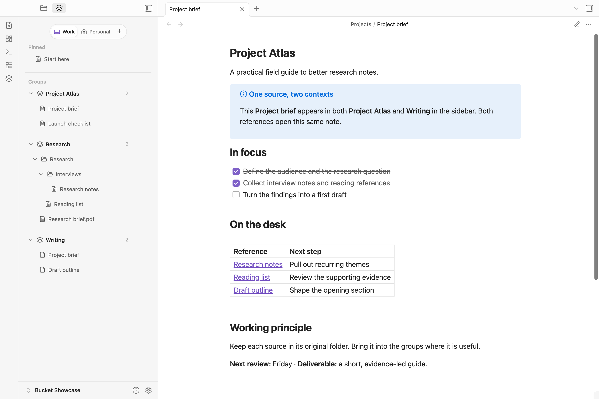
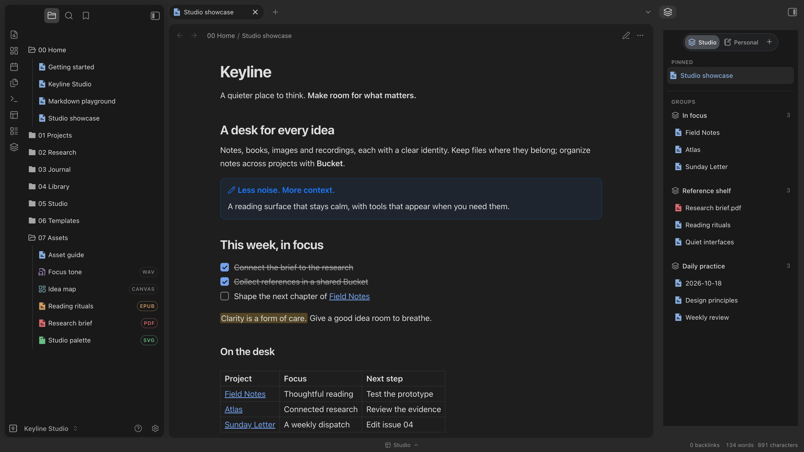

# Bucket Sidebar

**同一份资料，不止一种组织方式。**

一篇研究笔记，可以同时放在项目资料旁、阅读书架中，也可以出现在本周的工作清单里。Bucket Sidebar 围绕你正在做的事，组织 Markdown 笔记、PDF 与文件夹的引用，不搬动或复制原文件。保留已有目录，让每项任务都有顺手的资料视图。

[English](README.md) · [下载](https://github.com/BADtoBad/obsidian-bucket-sidebar/releases) · [Keyline 主题](https://github.com/BADtoBad/obsidian-keyline)

**Bucket 是右侧的分组面板。** 真实截图使用虚构、全英文的 [Keyline Studio 示例库](https://github.com/BADtoBad/obsidian-keyline#try-the-example-vault)，搭配可选的 Keyline 主题与 Keyline 交互插件。

## 围绕正在做的事组织资料

- **复用引用，不制造副本。** 同一篇笔记或 PDF 可以出现在多个 Bucket，每个引用打开的都是原文件，修改时不必维护多份版本。
- **区分场景，不必拆分 Vault。** 用 Space 区分工作、个人项目或研究，再在各空间内建立命名分组。
- **把当前需要的资料放近一点。** 置顶常用引用，拖动调整顺序，让侧栏符合眼前的任务。
- **引入文件夹，不必照单全收。** 浏览嵌套目录，排除分组中不需要的项目；需要新资料时，可在选定的真实路径中新建笔记或子文件夹。
- **调整组织方式，保留原文件。** 移除引用只会将它移出 Bucket，文件重命名后引用随之更新，支持的 Bucket 操作可以撤销。

## 为当前任务准备的侧栏

示例中，Studio 与 Personal 各自成为一个空间，起始笔记被置顶，资料按 In focus、Reference shelf 和 Daily practice 分组。你也可以为同一个 Vault 建立自己的使用视图，而不用反复重整真实目录。菜单与设置支持中文和英文，跟随 Obsidian 界面语言。

**左侧原生文件浏览器**的分类图标和底栏工作区切换来自 Keyline 交互插件。Bucket 当前支持 Markdown 与 PDF 文件引用，原生浏览器里展示的其它附件类型不属于 Bucket 功能。

## 推荐搭配

Bucket 可以独立使用。搭配 **[Keyline 主题](https://github.com/BADtoBad/obsidian-keyline)**，获得协调、开箱即用的明暗界面；再按需添加 **[Keyline 交互插件](https://github.com/BADtoBad/keyline-interactions)**，获得块编辑、文件分类图标与工作区切换。两者都不是 Bucket 的必需依赖。

## 文件与数据

引用和设置保存在本库插件的 `data.json` 中。常规操作不发起网络请求，无遥测或自更新。移除 Bucket 引用不会删除原文件；文件菜单中明确的 **删除文件** 操作则会删除真实文件。

## 安装与升级

可在 [Bucket Sidebar Community 页面](https://community.obsidian.md/plugins/bucket-sidebar)点击 **Add to Obsidian**，也可按下方说明手动安装。

需要 **Obsidian 1.7.7+**。备份 `.obsidian` 并关闭库，将 Releases 的 `main.js`、`manifest.json`、`styles.css` 放入 `.obsidian/plugins/bucket-sidebar/`，保留自己的 `data.json`。重新打开 Obsidian，启用 **Bucket Sidebar**。

## 语言与兼容性

当前版本为 **0.5.6**。界面支持中文和英文，切换 Obsidian 语言后重启生效；已保存的自定义名称保持不变。停用后重新启用插件会保留侧栏位置。发行验收环境为 macOS 桌面端，移动端尚未实机验证。详见 [发行验证](RELEASE-VERIFICATION.md)。

## 构建与反馈

使用 Node.js 22 和 pnpm 10.11.0，运行 `pnpm install --frozen-lockfile`、`pnpm typecheck`、`pnpm lint`、`pnpm test`、`pnpm build`、`pnpm check:release`。

类型检查还会在不载入 Node 全局类型的情况下验证浏览器端 ES2018 API。`check:release` 只将 `main.js`、`manifest.json` 和 `styles.css` 放入临时目录；插件发行附件仅上传这三个文件，手动安装 ZIP 应单独提供，不混入 Community 发行附件。

反馈请附版本、复现步骤和已去除隐私的截图，不要将私人 Vault 或插件数据文件上传到公开 Issue。

MIT，见 [LICENSE](LICENSE) 和 [THIRD_PARTY_NOTICES.md](THIRD_PARTY_NOTICES.md)。
